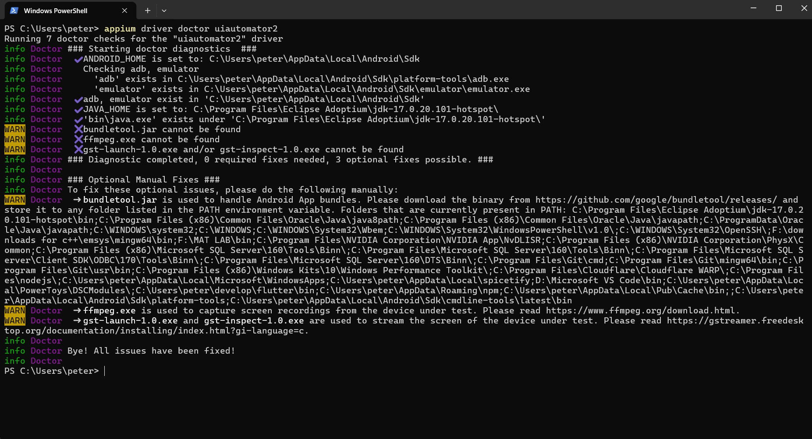
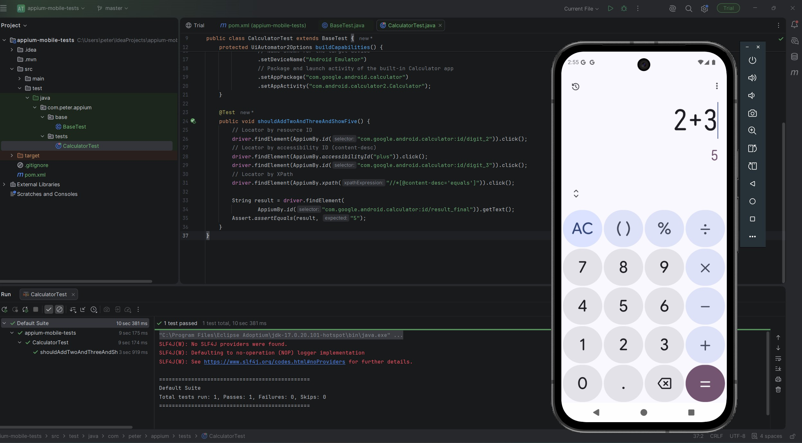
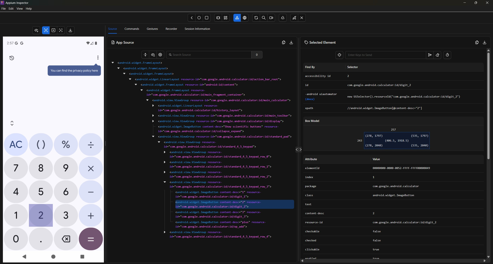
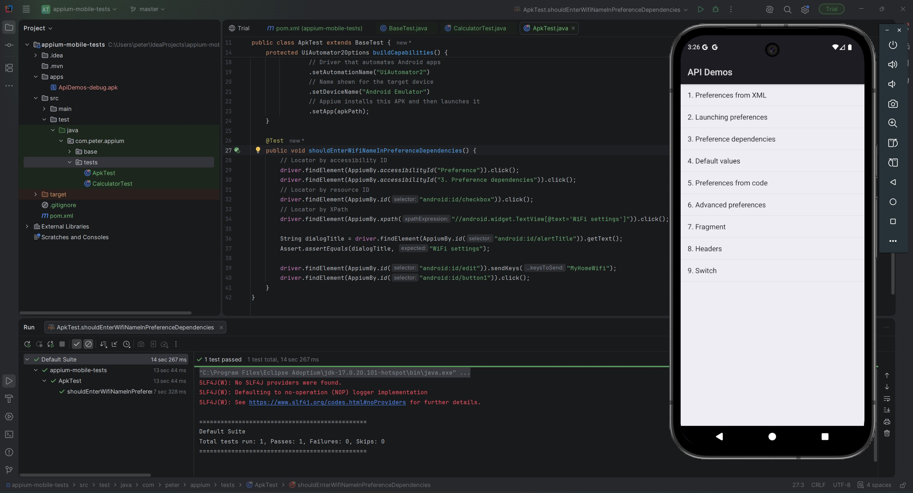
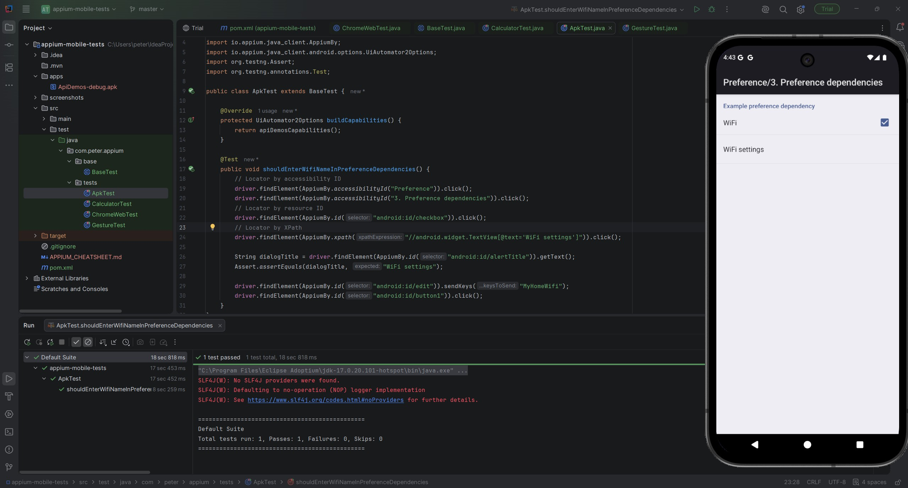
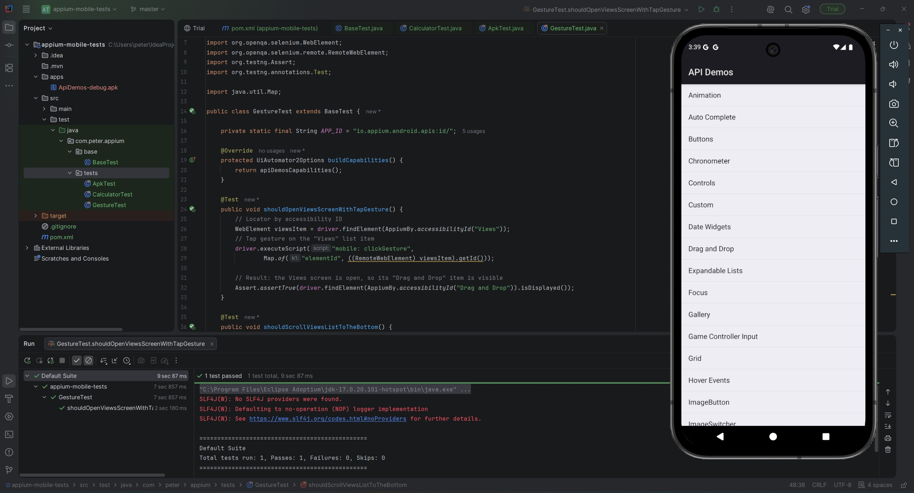
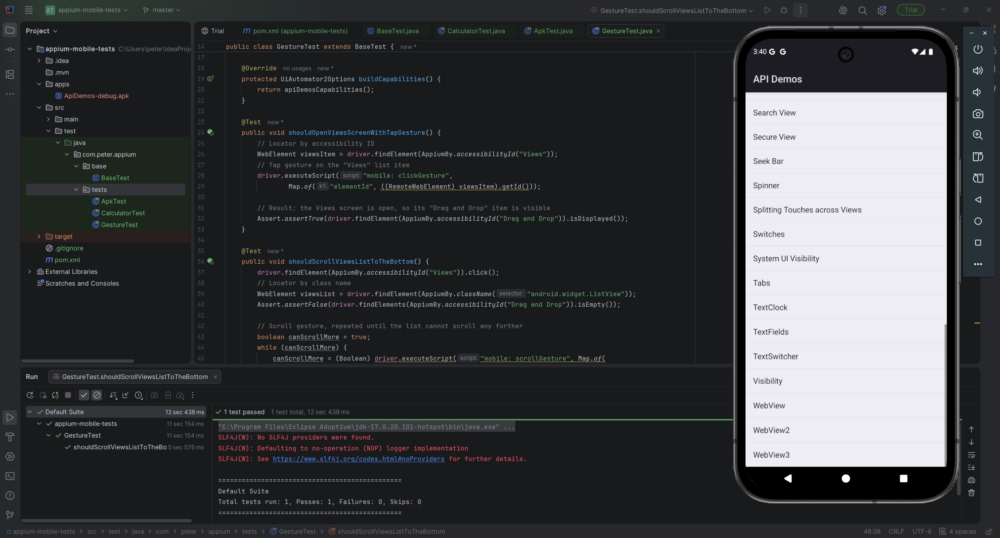
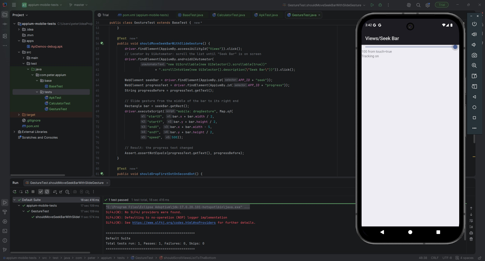
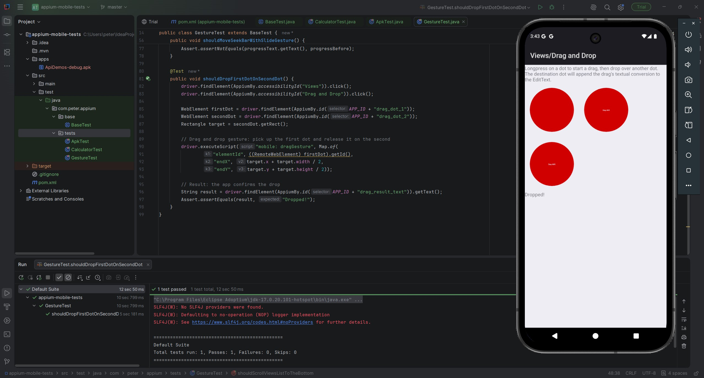
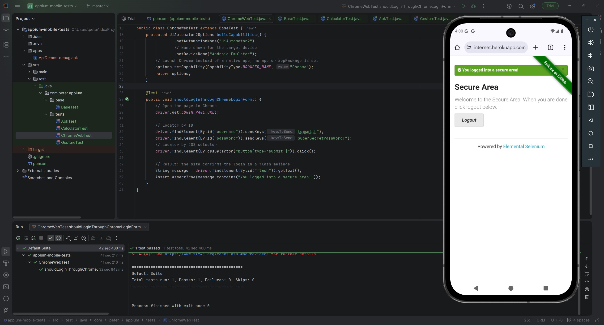

# Appium Mobile Tests (Android, Java)

## Author

Peter Gamal: [github.com/Potater420](https://github.com/Potater420)

Automated Android tests written with Appium, Java, TestNG and Maven by Peter Gamal.

## Test classes

| Class | What it covers |
|---|---|
| `CalculatorTest` | Built-in Calculator app: adds 2 + 3 and checks the result |
| `ApkTest` | Installs `apps/ApiDemos-debug.apk`, opens a preference dialog and types into it |
| `GestureTest` | Tap, Scroll, Slide (seek bar) and Drag & Drop on the ApiDemos app |
| `ChromeWebTest` | Opens a login page in Chrome and logs in |

Shared driver setup lives in `base/BaseTest.java`.

## Environment setup (Windows)

1. Install **Node.js** (LTS) from nodejs.org.
2. Install Appium and the Android driver:
   ```
   npm install -g appium
   appium driver install uiautomator2
   ```
3. Install **JDK 17** and set `JAVA_HOME` to its folder.
4. Install **Android Studio**, then in SDK Manager install the Android SDK, Platform-Tools and Command-line Tools.
5. Create an emulator in Device Manager (AVD) with a Google APIs image.
6. Set environment variables:
   - `ANDROID_HOME` = `C:\Users\<you>\AppData\Local\Android\Sdk`
   - `JAVA_HOME` = your JDK 17 folder
   - Add `%ANDROID_HOME%\platform-tools` and `%ANDROID_HOME%\cmdline-tools\latest\bin` to `PATH`
7. Verify:
   ```
   appium driver doctor uiautomator2
   ```
   All required checks pass. The three warnings (bundletool, ffmpeg, GStreamer) are optional and unused by these tests.
8. (Optional) Install **Appium Inspector** to find element locators.

## Running the tests

1. Start the emulator.
2. Start Appium. For the Chrome test, allow automatic ChromeDriver download:
   ```
   appium --allow-insecure=uiautomator2:chromedriver_autodownload
   ```
3. Run from IntelliJ (click the green arrow next to a test) or Maven:
   ```
   mvn test -Dtest=CalculatorTest
   mvn test -Dtest=ApkTest
   mvn test -Dtest=GestureTest
   mvn test -Dtest=ChromeWebTest
   ```

## Running on a real device

Tested on a Xiaomi Redmi Note 11 with `ApkTest`.

1. On the phone, enable Developer options and USB debugging.
2. On Xiaomi phones also enable **Install via USB** and **USB debugging (Security settings)**. Both require a signed-in Mi Account.
3. Connect the phone by USB and accept the "Allow USB debugging?" prompt.
4. Close the emulator and check that only the phone appears in `adb devices`. With a single device connected, Appium selects it automatically, so no test code changes are needed.
5. Start Appium and run `ApkTest`.

`BaseTest` sets the `appium:ignoreHiddenApiPolicyError` capability, which lets a session start on phones that restrict that Android setting. The emulator ignores it.

## Screenshots

### Phase 1: environment check


### Phase 2: built-in app and APK on the emulator




### Phase 3: real device


### Phase 3: gestures





### Phase 4: Chrome web test


## Cheat sheet

See [APPIUM_CHEATSHEET.md](APPIUM_CHEATSHEET.md).
